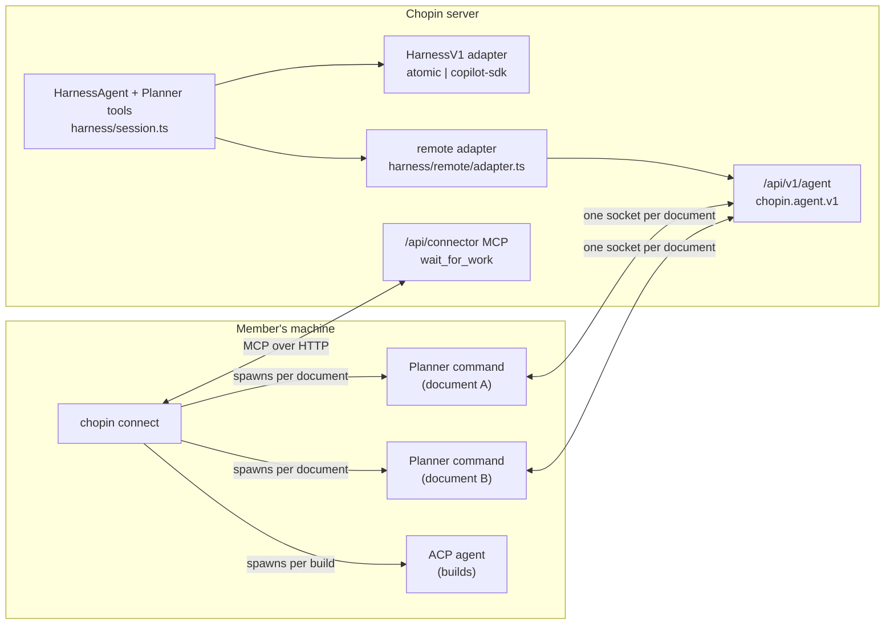
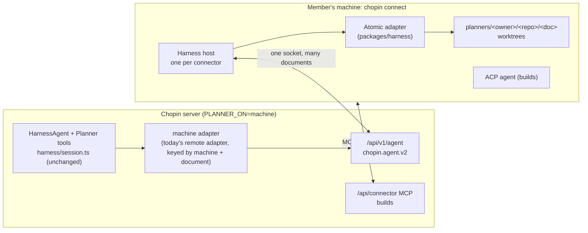
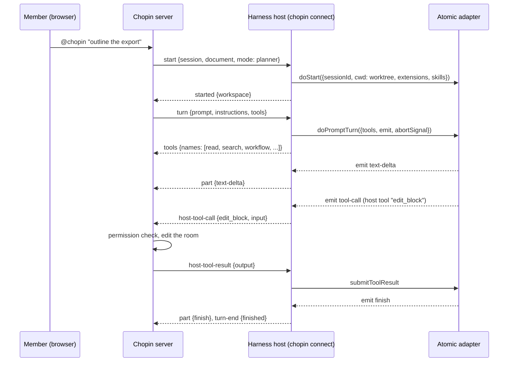

# Run Chopin's harnesses on a connected machine

Status: draft for review. Design only; nothing here is implemented.

## Summary

Today a document's Planner runs in one of two places. Under `HARNESS=copilot-sdk`
or `HARNESS=atomic` it runs in the Chopin server. Under `HARNESS=remote` it runs
outside the server, attached over the agent connection (`chopin.agent.v1`):
either a Planner command that `chopin connect --planner-command` starts once per
document, or a member's own agent session attached with their GitHub token.

This design replaces both kinds of attach and retires v1. The machine's own
`chopin connect` runs the same `HarnessV1` adapters the server runs (Atomic
first, then Copilot SDK), with the machine's model logins, checkout and
toolchain. Every Planner that does not run in the server runs through a
connected machine, including a person's own interactive one. The server keeps
everything it keeps today: the document, Chopin's Planner tools, prompts,
Decisions and permission checks. The two halves talk over `chopin.agent.v2` on
the same endpoint, opened once per machine and carrying every document that
machine serves.

The decisions, in one place:

| Topic                      | Decision                                                                                                                                                         |
| -------------------------- | ---------------------------------------------------------------------------------------------------------------------------------------------------------------- |
| Setting                    | `PLANNER_ON=server\|machine`. `HARNESS` keeps naming the adapter (`atomic`, `copilot-sdk`) wherever it runs. `HARNESS=remote` goes away.                         |
| Where the split is         | At `HarnessV1`. The server keeps `HarnessAgent`, tools and prompts; the machine runs only the adapter.                                                           |
| Wire                       | `chopin.agent.v2` on `/api/v1/agent`. One socket per connector. Machine-level `hello`, per-document `assign`/`claimed`/`unassign`, v1 session and turn messages. |
| v1                         | Retired completely, GitHub-token attach included. A person's own Planner runs through their connected machine.                                                   |
| Bearer                     | The connector's connection token, not a per-document Planner credential. `chopin_p_` credentials are retired.                                                    |
| Ownership                  | As today: one holder per document, the machine owner's delegated login. A dropped socket or a connector restart keeps it through the grace period.               |
| Automatic                  | With no machine chosen, the Planner runs on the requester's machine: their favorite, else the one last used for the document, as for builds.                     |
| Moves                      | Moving a document starts fresh sessions. With live workflow runs, the owner confirms first.                                                                      |
| Extensions and skills      | Come from connect settings: `--agent atomic -- -e <path> --skill <path>` applies to builds and the Planner alike.                                                |
| Adapter code in the binary | Chopin's adapter glue is compiled in. Atomic loads from a managed install at the version the server asks for; the Copilot CLI from the machine, version-checked. |
| Planner products           | Become Atomic extensions or packages loaded through connect settings. Their own Planner commands are retired.                                                    |
| ACP                        | An optional fallback Planner adapter for agents with no SDK, in a later phase.                                                                                   |

## Goals

- Run a document's Planner on a member's connected machine with the machine's
  own model login, checkout and tools, using the adapters Chopin already ships
  and tests (`apps/server/src/harness/atomic`, `apps/server/src/harness/copilot-sdk`).
- One agent connection per `chopin connect`, multiplexing every document whose
  Planner that machine runs.
- One way to configure a machine's agent: the extensions and skills given to
  `chopin connect --agent atomic -- ...` load for builds and for the Planner.
- Keep every guarantee the remote Planner gives today: one Planner per
  document, push or admin access rechecked before every session and turn,
  host tools run in the server under the owner, Decisions for every question,
  run cards and Stop/Resume.
- Make a Planner product an extension, not a program that speaks Chopin's wire.
- Show what the machine's Planner is doing in `chopin status`.

## Non-goals

- Moving builds off ACP. Builds keep `chopin connect --agent` or `-- <ACP command>`
  and the MCP work loop in `apps/connector/src/connection.ts`.
- Running summary and research background jobs on machines.
  `PLANNER_ON=machine` keeps the `BACKGROUND_JOBS=off` requirement that
  `HARNESS=remote` has (`apps/server/src/config.ts:237-240`).
- Resuming a harness session across a dropped connection, a server restart or
  a move to another machine. Sessions stay disposable, as
  [Session lifecycle](hosted-agent.md#session-lifecycle) already says.
- Migrating live Atomic workflow runs between machines.
- New adapters beyond Atomic, Copilot SDK and the optional ACP fallback.
- Loosening what a Planner turn may call by default. The Atomic allowlist
  (`FULL_PLANNER_TOOLS`, `apps/server/src/harness/atomic/adapter.ts:71-84`)
  applies on a machine as it does on the server. Only the machine owner's
  explicit `--planner-tools` opt-in adds their extensions' tools (decision 6).

## Where things are today

### Two Planner paths



| Piece                       | What it does now                                                                                                                                                                                                                                                                                    |
| --------------------------- | --------------------------------------------------------------------------------------------------------------------------------------------------------------------------------------------------------------------------------------------------------------------------------------------------- |
| Harness map                 | `harnesses` maps `copilot-sdk`, `atomic`, `remote` (`apps/server/src/harness/harnesses.ts:33-37`). `harnessFor` refuses `HARNESS_AUTH` under `remote` (86-90) and allows `HARNESS_EXTENSIONS` only for `atomic` (64-73).                                                                            |
| Contract suite              | `harnessContract` checks host tools only, built-ins off, JSON output, abort and single destroy (`apps/server/src/harness/contract.ts`). `harness-v1.ts` re-exports `@ai-sdk/harness` 1.0.146 types.                                                                                                 |
| Planner session             | `openPlannerSession` builds a full Atomic workspace only when `harness === "atomic"` (`harness/session.ts:159-161`), registers a `RemotePlanner` for `remote` (184-205), and gives remote run control with `followsUpRuns: false` (83-103).                                                         |
| Atomic adapter              | Auth `auto` or `ai-gateway` (`atomic/adapter.ts:49`); `auto` copies the host's `auth.json` (274-282); refuses resume (476); full sessions load operator extensions (623). Run state and HostInput come from the `FullPlanner` registry (`atomic/full.ts:19-39`). It never touches `sandboxSession`. |
| Copilot SDK adapter         | Uses each owner's GitHub App token per session (`copilot-sdk/adapter.ts:309-310`), `useLoggedInUser: false` (88), and finds the native Copilot CLI in `node_modules` or `COPILOT_CLI_PATH` (`agent/cli.ts`).                                                                                        |
| Remote adapter              | A `HarnessV1` that forwards `doStart` to the document's attached link (`remote/adapter.ts:30-60`). Links are keyed by document: `links: Map<channelId, AgentLink>` (`remote/registry.ts:28-53`).                                                                                                    |
| Agent connection            | `chopin.agent.v1`, version 1 (`packages/agent-link/src/protocol.ts:7-16`). `attach` names exactly one document (207-212). `AgentLink` checks the version at attach (`remote/link.ts:692-699`).                                                                                                      |
| Machine Planner credentials | `POST /api/connector/planner` issues a 15-minute `chopin_p_` credential for one document; the machine's owner holds the document through a delegated login (`remote/machine-planners.ts`).                                                                                                          |
| Dispatch                    | A protocol 4 connector polls `wait_for_work` with `planners`; the server answers with the documents its owner chose the machine for, skipping one another account holds (`experiments/routes.ts:369-404`, 1329-1343).                                                                               |
| Planner commands            | `servePlanners` and `dispatchedPlanners` spawn the command per document with `CHOPIN_PLANNER_TOKEN` and `CHOPIN_GITHUB_TOKEN*` in its environment, restart it on backoff and stop its process group (`apps/connector/src/planner.ts:53-160`; [env table](agent-connection.md#environment)).         |
| Connect settings            | `--agent atomic` runs `atomic-acp`, and words after `--` pass through to Atomic (`packages/protocol/agents.ts:82-93`). `--planner-command` and `--planner` are separate options (`apps/connector/src/main.ts:369-373`, 411-424).                                                                    |
| CLI binary                  | `bun build --compile` for five targets (`apps/connector/scripts/build-binaries.ts`). The connector depends only on the ACP SDK, the MCP SDK and two workspace packages (`apps/connector/package.json`).                                                                                             |

### What hurts

- **Two products in one setting.** `HARNESS` picks an adapter for the server
  and, as `remote`, a place for the Planner. A machine cannot run the Atomic
  adapter Chopin already tests; it has to bring a program that reimplements the
  wire.
- **Every Planner product reimplements the same things.** Attaching, the
  credential lifecycle, reconnects, worktree handling, Decisions, run reports
  and token renewal live in each Planner command. Chopin's own Atomic adapter
  already does the Atomic half of that, tested.
- **A socket, a process and a credential per document.** Ten documents on one
  machine are ten processes, ten connections and ten credential refreshes.
- **Two sets of agent settings.** Extensions given to `--agent atomic -- -e ...`
  reach builds only. The Planner gets whatever its command loads.

## The proposal

### Topology



The server half barely changes. Under `PLANNER_ON=machine` the server's
`HarnessV1` is today's remote adapter: it forwards `doStart` and
`doPromptTurn` over the socket and runs host tools when asked. What changes is
how it finds the socket: by the machine holding the document, not by a link that
attached to that one document.

The machine half is new: a **harness host** inside `chopin connect`. It opens
the agent connection, takes the documents Chopin assigns, and turns `start`,
`turn`, `abort`, `stop`, `resume` and `destroy` into calls on a real
`HarnessV1` adapter. It is the inverse of the remote adapter.

### Why split at `HarnessV1`

`chopin.agent.v1` is already a `HarnessV1` transport. `start` is `doStart`,
`turn` is `doPromptTurn` with `tools`, `instructions` and `responseFormat`,
`part` is `emit`, `host-tool-call`/`host-tool-result` are a host tool call and
`submitToolResult`, `abort` is the turn's `abortSignal`, `destroy` is
`doDestroy`. Atomic's extras (HostInput as `input-request`, workflow runs as
`runs`, Stop/Resume as `stop`/`resume`) are in it too. So the boundary already
exists and is tested from both sides (`remote/link.test.ts`,
`remote.contract.test.ts`). The harness host is the piece nobody has written
yet, except inside each Planner command.

### Settings

| Variable                                        | `PLANNER_ON=server` (default)                     | `PLANNER_ON=machine`                                                                                                          |
| ----------------------------------------------- | ------------------------------------------------- | ----------------------------------------------------------------------------------------------------------------------------- |
| `HARNESS`                                       | Adapter the server runs (`copilot-sdk`, `atomic`) | The one adapter every machine must run. A connector offering another is refused with `harness-unsupported`. Default `atomic`. |
| `HARNESS_AUTH`                                  | As today                                          | Refused at startup: model logins live on the machine.                                                                         |
| `HARNESS_EXTENSIONS`                            | As today (Atomic only)                            | Refused at startup: extensions come from each machine's connect settings.                                                     |
| `MODEL`                                         | As today                                          | Optional. Passed as the turn's requested model, as under `remote` today.                                                      |
| `BACKGROUND_JOBS`                               | As today                                          | Must be `off`.                                                                                                                |
| `/api/v1/agent`                                 | 404                                               | Speaks `chopin.agent.v2` only. v1 is not offered.                                                                             |
| `PLANNER_ATTACH_GRACE_MS`, `AGENT_CONNECTION_*` | Unused                                            | As today, applied per machine connection.                                                                                     |

Until PR 8, `HARNESS=remote` still serves v1 on its own; a server never speaks
both. PR 8 removes it, and startup then refuses `HARNESS=remote` with a message
pointing at `PLANNER_ON=machine`.

### Connect settings

The Planner uses the same agent settings as builds. For Atomic, the connector
reads Atomic's own resource flags out of the words after `--`:

```sh
chopin connect . --agent atomic -- -e /opt/planner-pkg --skill ~/skills/review --model openai/gpt-5.5
```

| Words after `--`                  | Builds (ACP)                     | Planner (harness host)                                   |
| --------------------------------- | -------------------------------- | -------------------------------------------------------- |
| `-e <path>`, `--extension <path>` | Passed to `atomic-acp`, as today | `additionalExtensionPaths` of every full Planner session |
| `--skill <path>`                  | Passed to `atomic-acp`, as today | `additionalSkillPaths`                                   |
| `--model <provider/model>`        | Passed to `atomic-acp`, as today | Default model when the server sends none                 |
| Anything else                     | Passed to `atomic-acp`, as today | Ignored, and `chopin status` lists what was ignored      |

Atomic 0.9.31's CLI documents `--extension, -e` and `--skill <path>`, and its
resource loader takes `additionalExtensionPaths` and `additionalSkillPaths`
(checked in a sibling checkout's `node_modules`; this repository pins 0.9.37, so
PR 4 rechecks). Paths must be absolute and exist, the rule `checkedExtensions`
applies on the server (`harnesses.ts:64-73`). `--planner-command` and `--planner`
are retired; see [Rollout](#rollout-as-stacked-prs).

Two `chopin connect` options, outside the words after `--`, apply to the
Planner only:

- `--planner-sessions <n>` sets how many Planner sessions the machine runs at
  once (default 2).
- `--planner-tools` also offers the tools of connect-configured extensions on
  Planner turns, beyond `FULL_PLANNER_TOOLS`. They are declared in `tools` and
  shown in Work details. Without it, those tools work only inside workflows.

A connector runs the Planner only when its agent has a harness adapter
(`--agent atomic` now, `--agent copilot` from PR 7). A connector given
`-- <ACP command>` runs builds only, unless the ACP fallback adapter lands.

### A person's own Planner

Under v1 a member could make their own agent session in a checkout the
document's Planner by attaching it with their GitHub token. That goes away with
v1. Instead they run `chopin connect` in that checkout with the agent, extensions
and skills their session used, and either choose that machine for the document
or leave it on Automatic (their favorite machine first). The Planner then runs
through their connector with their model login, worktree and tools, and acts as
them.

They talk to it the way everyone else does: `@chopin` in Chat. A local coding
agent can still hand it an instruction through
[local agent MCP](local-agent-mcp.md)'s `invoke_planner`. That reaches the
machine holding the document, or Automatic's pick for the caller when no machine
holds it.

### The door set

Read the names alone; they say what the machine and server owe each other.

| Door                     | Side    | Promise                                                                              |
| ------------------------ | ------- | ------------------------------------------------------------------------------------ |
| `hello` / `welcome`      | both    | The machine says which harness it runs; the server says whether it will take it.     |
| `assign` / `claimed`     | both    | The machine now holds this document's Planner and is ready to start sessions for it. |
| `unassign` / `release`   | both    | The machine no longer holds the document. No grace period.                           |
| `start` / `started`      | both    | One harness session exists for one held document.                                    |
| `turn` ... `turn-end`    | both    | One prompt turn runs to exactly one end.                                             |
| `host-tool-call` ⚠       | machine | Run a Chopin tool in the server. The only way the machine changes the document.      |
| `input-request`          | machine | Ask the document's members through Decisions.                                        |
| `runs`, `stop`, `resume` | both    | Report and control the session's workflow runs.                                      |

The ⚠ door is the only one with a durable effect in Chopin. It is today's
`host-tool-call`, checked against the turn's tool list, run under the
document's Planner owner and the [permission checks](hosted-agent.md#permission-checks).
Pushing to GitHub happens on the machine with the owner's own token, and GitHub
enforces it, as for builds.

## Wire: `chopin.agent.v2`

The rules of [Agent connection](agent-connection.md) still hold unless
listed here: JSON text frames of at most 2 MiB, strict objects, pings, close
codes, the Decisions mapping, stream parts, structured tool errors. v2 changes
the handshake and adds a document layer. Session and turn messages stay as
they are, so the server's `RemoteSession` and its tests carry over.

### Endpoint and bearer

- Same path, `/api/v1/agent`. The upgrade must offer `chopin.agent.v2`. Any
  other upgrade, a v1 client's included, gets 426 with
  `"supported": ["chopin.agent.v2"]`.
- `Authorization: Bearer <connection token>`, the token
  `POST /api/connector/connections` returns (`apps/connector/src/machine.ts:317-333`).
  It names the machine, the checkout's repository and the connector's
  protocol, and dies with that connection or a server restart. A GitHub token
  or a `chopin_p_` credential is refused with 401.
- A connector opens the socket only after its MCP connection registers, and
  closes it when that connection ends. A connector restart, or a new connection
  token after a server restart, opens a new socket.

### Handshake

```text
client  { "type": "hello", "version": 2, "harness": { "name": "atomic", "version": "0.9.37" },
          "resources": { "extensions": ["planner-pkg"], "skills": ["review"] },
          "capacity": { "sessions": 4 },
          "checkout": { "origin": "git@github.com:octo-org/score.git", "branch": "main", "head": "3f2c…" } }

server  { "type": "welcome", "version": 2, "machine": { "id": "m_…", "label": "build-box" },
          "repository": "octo-org/score", "harness": { "name": "atomic", "version": "0.9.37" }, "model": "openai/gpt-5.5" }
server  { "type": "refused", "code": "harness-unsupported", "message": "This Chopin runs Planners with copilot-sdk; this machine offers atomic." }
```

- `resources` carries names only (the last path segment), never paths, for the
  Machines page and Chat's machine menu.
- `hello.harness.version` is the version the connector has loaded, if any.
  `welcome.harness.version` is the one the server asks for. When the managed
  install lacks it, the connector installs it (see
  [Bundling](#bundling-the-adapters-into-chopin)) before it answers any
  `assign`; a failed install answers `claim-failed` with `harness-unavailable`.
- `capacity.sessions` is how many harness sessions the machine runs at once
  (`--planner-sessions`, default 2). The server never starts more on it. Live
  workflow runs do not use session slots; they are counted on their own and
  shown in `chopin status`.
- New refusal codes: `harness-unsupported` (close 4422) and
  `machine-revoked` (4403). `planner-attached` and `sign-in-required` no longer
  apply at this level.

### Documents

The server decides which documents a machine holds. It reuses today's rule
(`plannerDocuments`, `experiments/routes.ts:377-404`): documents in the
machine's repository that its owner chose this machine for, minus any whose
Planner another account holds. One case is new. When someone asks a document's
Planner for a turn (`@chopin` or `invoke_planner`) and nobody chose a machine for
it, Automatic picks the requester's machine with the rule builds use: their
favorite, else the one last used for the document, else any free one
(`experiments/connections.ts:266-267`). Automatic never moves a Planner a
machine already holds. A requester with no machine connected for the repository
is told to run `chopin connect` in a checkout of it.

The server takes the ownership through `PlannerAttachments` with the machine's
delegated login before it sends `assign`, so `assign` means "you hold it now".

```text
server  { "type": "assign", "document": { "id": "5f0c…e21", "title": "Score export", "url": "https://chopin.example/octo-org/score/plan", "repository": "octo-org/score" }, "resumed": false }
client  { "type": "claimed", "document": "5f0c…e21" }
client  { "type": "claim-failed", "document": "5f0c…e21", "code": "worktree-failed", "message": "git worktree add failed: …" }

server  { "type": "unassign", "document": "5f0c…e21", "code": "chosen-elsewhere", "message": "The document chose another machine." }
client  { "type": "release", "document": "5f0c…e21" }
```

- `claimed` comes once the connector has the document's worktree and the
  adapter loaded. Until then Chat's machine button says **Starting…**, as now.
- `claim-failed` releases the ownership at once. `code` is one of
  `worktree-failed`, `harness-unavailable`, `at-capacity`, `failed`.
- `unassign` codes: `chosen-elsewhere`, `access-revoked`, `document-archived`,
  `document-deleted`, `planner-reset`, `machine-revoked`. Each matches a row of
  today's [ownership table](agent-connection.md#ownership). Every open
  session of the document ends as if `destroy` had arrived.
- `release` is the machine letting go of one document, for example after a
  local failure. No grace period. A connector that exits does not release; see
  [grace](#ownership-grace-reconnects-and-moves).
- `resumed: true` marks an `assign` re-sent after a reconnect within the grace
  period. Ownership and its generation are the same; sessions are new.

### Sessions and turns

Only two messages change shape:

```text
server  { "type": "start", "session": "s_…", "document": "5f0c…e21", "mode": "planner" }
client  { "type": "started", "session": "s_…", "workspace": { "kind": "worktree", "branch": "chopin/planner/5f0c…e21", "head": "3f2c…" } }
client  { "type": "start-failed", "session": "s_…", "code": "at-capacity", "message": "This machine already runs 4 Planner sessions." }
```

- `start.document` is required and must be a document the connection holds,
  else the client answers `start-failed` with `failed` and the server treats it
  as a protocol error.
- `started.workspace` replaces the server's own `PlannerWorkspace`
  (`atomic/workspace.ts`), so `channel.instructions(...)` can tell the Planner
  it is in a worktree of the repository (`harness/session.ts:206-208`).
- `start-failed.code` is optional: `at-capacity`, `harness-unavailable`,
  `failed`.

Every other v1 message is reused verbatim: `turn`, `abort`, `tools`, `part`,
`host-tool-call`, `host-tool-result`, `turn-end`, `input-request`,
`input-cancel`, `input-result`, `runs`, `stop`, `resume`, `control-result`,
`destroy`, `detach`, `error`. Their ids are unique per connection, so routing by
session is enough.

### One turn, end to end



### Version rules

- v2 is a new subprotocol, as [Versions](agent-connection.md#versions)
  requires. `hello.version` is `2`.
- `@chopin/agent-link` carries the v1 and v2 schemas side by side until PR 8
  deletes v1. A server speaks one of them, chosen by its settings, never both.
- Additive fields within v2 follow the strict-object rule: a server rejects
  fields it does not know, so a new field ships in the server before any client
  sends it.

## Ownership, grace, reconnects and moves

```mermaid
stateDiagram-v2
  [*] --> Free
  Free --> Assigned: owner chooses machine M, or Automatic picks\nthe requester's machine; server takes ownership, sends assign
  Assigned --> Held: claimed
  Assigned --> Free: claim-failed
  Held --> Grace: M's socket drops or its connector exits
  Grace --> Held: M reconnects within grace\nassign (resumed)
  Grace --> Free: grace ends
  Held --> Free: unassign or release
  Held --> Assigned: owner chooses machine N and confirms\nunassign to M, assign to N
```



- **One holder per document.** Unchanged. The holder is the machine owner's
  delegated login (`machine-planners.ts`). Another account's choice of its own
  machine is skipped while this one holds the document, as today.
- **Rechecks.** Before every `start` and `turn`, and every 5 minutes, the server
  checks the machine (paired, authorized), the owner's admission, push or admin
  access, and the document (`endpoint.ts:239-254`). A failed check now sends
  `unassign` with `access-revoked` for that document instead of closing the
  socket, unless the failure is the machine itself (`machine-revoked` closes
  everything).
- **Grace.** A dropped socket or a connector that exits (Ctrl-C, a restart, a
  crash) puts every document it held into grace for `PLANNER_ATTACH_GRACE_MS`.
  The same machine reconnecting gets `assign` with `resumed: true` for each one
  still in grace. Its sessions, turns and open questions ended when the socket
  closed, as in v1: no turn is replayed.
- **Moving a document.** When the owner chooses machine N, the server sends
  `unassign` (`chosen-elsewhere`) to M, releases without grace, takes the
  ownership again for N and sends `assign`. N's first session starts empty. Its
  first turn bootstraps from the bounded transcript and the current document,
  which is how every harness session starts today
  ([Session lifecycle](hosted-agent.md#session-lifecycle)). Nothing on M
  is copied.
- **Workflow runs on a move.** If M reports live workflow runs, the machine menu
  first lists them, says they will stop, and asks the owner to confirm. The move
  happens only after they confirm; cancelling keeps the document on M. Once
  moved, the runs become **stopped** cards and their state stays in M's Atomic
  workflow store. Unassigns nobody chose (`access-revoked`, `machine-revoked`,
  an archived or deleted document) do not ask.
- **Server restart.** Unchanged: every ownership is released and connection
  tokens die. Connectors register again, open a new socket, and get `assign`
  for every document still chosen. Automatic picks again on the next request.

## Builds and Planners on the same machine

| Concern         | Decision                                                                                                                                                                                                                                                                                  |
| --------------- | ----------------------------------------------------------------------------------------------------------------------------------------------------------------------------------------------------------------------------------------------------------------------------------------- |
| Working trees   | Builds keep `runs/<run id>`. Each document's Planner works in `planners/<owner>/<repo>/<document id>`, the path Planner commands use today. The connector now creates it (`git worktree add --detach` at the checkout's `origin` default branch) and never resets one with local changes. |
| Running at once | A build and Planner sessions run in parallel; they share no worktree. Builds stay one at a time per checkout, as now.                                                                                                                                                                     |
| Session cap     | `capacity.sessions`, default 2, set with `--planner-sessions <n>`. Live workflow runs do not take a slot; the connector counts them separately and `chopin status` shows both.                                                                                                            |
| Git locks       | Worktree creation retries on `index.lock`/worktree lock contention with the checkout's own Git operations.                                                                                                                                                                                |
| Shutdown        | Ctrl-C reports running builds stopped (today), destroys sessions and closes the socket with `detach`. Held documents go into grace, so connecting again within it keeps them. A second Ctrl-C exits at once.                                                                              |
| `Build plan`    | Unchanged. It goes to the chosen machine over MCP, and usually lands next to the Planner that wrote the plan.                                                                                                                                                                             |

## Security

### What the harness gets

| Credential                                                 | Where it lives                                  | The machine's Planner harness                                                                                                                                    |
| ---------------------------------------------------------- | ----------------------------------------------- | ---------------------------------------------------------------------------------------------------------------------------------------------------------------- |
| Model login (`~/.atomic/agent/auth.json`, `copilot login`) | The machine                                     | Read by the adapter in memory, as `HARNESS_AUTH=auto` does on a server today. Never sent to Chopin.                                                              |
| Owner's GitHub App token for host tools                    | The server                                      | Never. Host tools run in the server with the delegated login's token.                                                                                            |
| Owner's GitHub App token for pushing                       | The connector, renewed 25 minutes before expiry | `CHOPIN_GITHUB_TOKEN_FILE` and `CHOPIN_GITHUB_TOKEN_EXPIRES_AT` in the environment of commands Atomic starts. The raw `CHOPIN_GITHUB_TOKEN` variable is dropped. |
| Connection token (v2 bearer)                               | Connector memory                                | Never.                                                                                                                                                           |
| Machine token `chopin_m_`                                  | Base dir file                                   | Never given. Readable by any process of the same user, as it is for build agents today (risk 3).                                                                 |
| `chopin_p_` Planner credentials                            | Retired                                         | n/a                                                                                                                                                              |
| `--env` values                                             | `config.json` (0600)                            | In the environment, as for Planner commands today.                                                                                                               |

### Trust boundary

- The server trusts the machine exactly as it trusts an attached v1 client: its
  parts, its own tool reports and its run reports are the machine's word. Host
  tool calls are checked against the turn's tool list, and a reported run never
  starts a Planner turn (`followsUpRuns: false`, `harness/session.ts:101`).
- A machine runs Planners only for documents its owner chose it for, or that
  Automatic gave it because its owner asked. Nobody else's choice or request
  lands on it, so a shared build box cannot be steered into planning someone
  else's document.
- Extensions and skills run as the machine user, chosen by the machine owner.
  They do not reach the server; the server sees only their names.
- Push checks stay where they are. The server checks push or admin access at
  assign, before every `start` and `turn`, and every 5 minutes. A push itself is
  between the machine and GitHub, with the owner's token, as for builds and
  Planner commands now ([Which GitHub account pushes](chopin-cli.md#which-github-account-pushes)).

## Bundling the adapters into `chopin`

The CLI is one `bun build --compile` executable per platform. The adapters'
own code is small TypeScript; the runtimes behind them are not.

| Part                                              | Size and shape                                                                                                                                                             | Decision                                                                                                                                                                                                                                                                 |
| ------------------------------------------------- | -------------------------------------------------------------------------------------------------------------------------------------------------------------------------- | ------------------------------------------------------------------------------------------------------------------------------------------------------------------------------------------------------------------------------------------------------------------------ |
| Chopin's adapter glue (`packages/harness`)        | Plain TypeScript                                                                                                                                                           | Compiled into `chopin`.                                                                                                                                                                                                                                                  |
| `@ai-sdk/harness`                                 | Plain TypeScript                                                                                                                                                           | Compiled in.                                                                                                                                                                                                                                                             |
| `@bastani/atomic`                                 | 51 MB package; more than 250 MB with dependencies, glibc and musl native modules and an embedded PostgreSQL ([Atomic caveats](self-hosting.md#choose-and-trust-a-harness)) | Not compiled in. Loaded at runtime with `import()` from an install the connector manages in `<base dir>/harness/atomic/<version>`, at the version the server asks for in `welcome`, installed with the machine's `npm` on first use. Never the machine's global install. |
| `@github/copilot-sdk`                             | Plain JavaScript                                                                                                                                                           | Compiled in.                                                                                                                                                                                                                                                             |
| Copilot CLI (`@github/copilot-<platform>-<arch>`) | Native executable per platform (`agent/cli.ts`)                                                                                                                            | Not compiled in. The adapter drives the `copilot` the machine already installs for `--agent copilot`, found on `PATH` or through `COPILOT_CLI_PATH`, and checks its version.                                                                                             |

Why not embed: each of the five targets would have to carry Atomic's native
modules (glibc and musl builds on Linux) and its embedded PostgreSQL, and
everyone who only runs builds would download a CLI several hundred megabytes
larger. Why a managed install rather than the machine's global `@bastani/atomic`:
the adapter is tested against one Atomic version (`package.json` pins 0.9.37),
the server asks for that version, and a global install drifts. A machine set up
for `--agent atomic` already has Node.js 22.19 and `npm`
(`packages/protocol/agents.ts:82-93`).

PR 6 has to prove that a compiled Bun executable can `import()` an absolute
path outside its bundle and load that package's native modules on all five
targets. If it cannot, the fallback is a small helper script run by the
machine's Node.js that hosts the adapter over stdio (risk 1).

## Observability

`chopin status` gains a Planner block, and `--json` the same fields under
`planner`:

```text
Connector:  running for /home/me/src/score (pid 4242, chopin 0.1.0, the service)
Planner:    atomic 0.9.37 (from /home/me/.local/state/chopin/connector/harness/atomic/0.9.37)
            extensions: planner-pkg · skills: review · ignored: --thinking high
            connection: up since 10:42 (chopin.agent.v2), 2 of 2 sessions in use, 1 workflow run live
            https://chopin.example/octo-org/score/plan   turn running 34s, 1 workflow run live
            https://chopin.example/octo-org/score/export idle, held since 09:15
```

- A document that failed to claim, or whose sessions keep failing, shows its last
  error, redacted with `redacted()` (`apps/connector/src/connection.ts:59-67`).
- The connector keeps this state in its base dir, as it keeps chosen Planners
  and start failures today (`chosenPlanners`, `startFailures` in `workspace.ts`),
  so `chopin status` can read it from another process.
- The server's Machines page shows "Runs Planners with Atomic 0.9.37" and the
  resource names from `hello`. Chat's machine button keeps its states.
- Server logs name each assign, claim, unassign and grace expiry with machine id,
  document id and code. No prompts, no tool inputs.

## What a Planner package changes

A Planner product that ships today as a `--planner-command` program becomes an
Atomic extension or package:

| Today, in the Planner command                                                        | After                                                                                                               |
| ------------------------------------------------------------------------------------ | ------------------------------------------------------------------------------------------------------------------- |
| Reads `CHOPIN_URL`, `CHOPIN_DOCUMENT`, `CHOPIN_PLANNER_TOKEN`; dials `/api/v1/agent` | Nothing. The connector holds the connection.                                                                        |
| Reconnect, credential refresh, exit on 401                                           | Nothing.                                                                                                            |
| Creates its worktree at `CHOPIN_WORKTREE`                                            | Nothing. The session's working directory is the document's worktree.                                                |
| Wraps Atomic itself, maps HostInput to `input-request`, reports `runs`               | Nothing. Chopin's adapter does it.                                                                                  |
| Its prompts and procedures                                                           | Skills, prompt templates and workflows in the package.                                                              |
| Its own tools                                                                        | Extension tools, usable inside its workflows, and on Planner turns when the machine owner passes `--planner-tools`. |
| Reads `CHOPIN_GITHUB_TOKEN`                                                          | Reads the file at `CHOPIN_GITHUB_TOKEN_FILE` before each use.                                                       |
| Started with `--planner-command "pkg-planner …"`                                     | Loaded with `chopin connect . --agent atomic -- -e /path/to/pkg`. The same package also loads into builds.          |

## Alternatives considered

| Option                                                                                                  | For                                                                                  | Against                                                                                                                                            | Verdict               |
| ------------------------------------------------------------------------------------------------------- | ------------------------------------------------------------------------------------ | -------------------------------------------------------------------------------------------------------------------------------------------------- | --------------------- |
| A. Keep `HARNESS=remote` and Planner commands; ship a reference command built on Chopin's adapter       | No protocol change                                                                   | Still a process, socket and credential per document; settings still split; every product still owns the wire                                       | Rejected              |
| B. Split at `HarnessV1`, harness host in `chopin connect`, one socket per machine (this design)         | Reuses the tested adapters and the v1 session messages; one place for agent settings | A new subprotocol; the connector grows a runtime dependency on Atomic                                                                              | **Chosen**            |
| C. Run the whole Planner (`HarnessAgent`, tools, prompts) on the machine; server exposes tools over MCP | Server becomes thinner                                                               | Prompts, permission checks and room writes would trust the machine; Chopin's tools would need a second transport; two copies of `session.ts` logic | Rejected              |
| D. Keep v1, one socket per document, opened by the connector itself                                     | No new handshake                                                                     | N sockets and N credentials per machine; per-document `attach` cannot carry machine capabilities or capacity                                       | Rejected              |
| E. Run the adapter in a child process per machine instead of in the connector process                   | Crash and memory isolation from builds; its own environment                          | A second local protocol; more moving parts on day one                                                                                              | Deferred (decision 2) |
| F. ACP as the only Planner transport on the machine                                                     | One agent protocol for builds and Planner                                            | ACP has no host tool results, structured output, HostInput or run control; loses what the adapters already do                                      | Fallback only (PR 9)  |
| G. Keep v1 GitHub-token attach for a person's own session beside v2                                     | People keep attaching their own session without `chopin connect`                     | Two ways to be a Planner, two admission paths, and a Planner that depends on a live browser sign-in                                                | Rejected (decision 1) |

## Rollout as stacked PRs

Each PR is reviewable alone and leaves `main` working. Until PR 8 a server runs
either the old path (`HARNESS=remote` on v1) or `PLANNER_ON=machine` on v2,
never both. PR 8 removes v1 completely.

| PR | Change                                                                                                                                                                                                                                                                                                                                                                                                                                                            | Acceptance tests                                                                                                                                                                                                                                                                                                                                                                                                                                                                                                                                                    |
| -- | ----------------------------------------------------------------------------------------------------------------------------------------------------------------------------------------------------------------------------------------------------------------------------------------------------------------------------------------------------------------------------------------------------------------------------------------------------------------- | ------------------------------------------------------------------------------------------------------------------------------------------------------------------------------------------------------------------------------------------------------------------------------------------------------------------------------------------------------------------------------------------------------------------------------------------------------------------------------------------------------------------------------------------------------------------- |
| 1  | Move the Atomic adapter, `full.ts` run control, the Copilot SDK adapter and runtime into `packages/harness`, free of server imports. `human-input.ts`, `workspace.ts` and `checkout.ts` stay in the server.                                                                                                                                                                                                                                                       | `atomic.contract.test.ts`, `copilot-sdk/*.test.ts` and `harness/contract.test.ts` pass unchanged from their new home; `bun run types`; the server imports the package.                                                                                                                                                                                                                                                                                                                                                                                              |
| 2  | `chopin.agent.v2` schemas in `@chopin/agent-link`, beside v1 until PR 8; v2 section in `docs/agent-connection.md`.                                                                                                                                                                                                                                                                                                                                                | Protocol tests for every new message and limit; v1 tests untouched.                                                                                                                                                                                                                                                                                                                                                                                                                                                                                                 |
| 3  | Server: `PLANNER_ON`, connection-token admission on v2, `assign`/`claimed`/`unassign` driven by `plannerDocuments`, Automatic and `PlannerAttachments`, remote adapter keyed by machine and document, grace on connector exit. The machine menu asks before moving a document with live workflow runs.                                                                                                                                                            | With the agent-link test client speaking v2: assign on choice; with nothing chosen, `@chopin` assigns the requester's favorite, else the machine last used for the document; claim-failed releases; reconnect within grace keeps the generation; choosing machine N unassigns M and assigns N; with live runs on M, nothing moves until the owner confirms; push loss unassigns one document; revoking the machine closes the socket; a v1 upgrade gets 426 listing only v2 and a GitHub token gets 401; `PLANNER_ON=machine` with `HARNESS_AUTH` refuses to start. |
| 4  | Connector: harness host behind an interface, Atomic from a managed install at the version `welcome` asks for, document worktrees, Atomic flags read from connect settings, `--planner-sessions`, `--planner-tools`.                                                                                                                                                                                                                                               | E2E against a real server with Atomic's stub model (`atomic/model-stub.ts`): an `@chopin` turn edits the document; a questionnaire round-trips through Decisions; Stop/Resume a workflow run; live runs leave session slots free; Ctrl-C then connecting within grace keeps every document; an extension tool reaches Planner turns only with `--planner-tools`; a build runs during a Planner turn.                                                                                                                                                                |
| 5  | `chopin status` Planner block and `--json`; Machines page harness line.                                                                                                                                                                                                                                                                                                                                                                                           | Status snapshot tests; the Machines page shows the harness and resource names; nothing in status output matches the token patterns `redacted()` masks.                                                                                                                                                                                                                                                                                                                                                                                                              |
| 6  | Compiled-binary support: runtime `import()` of the managed Atomic, `chopin harness check`.                                                                                                                                                                                                                                                                                                                                                                        | CI builds each binary; on every target with a CI runner it installs the pinned Atomic, runs `chopin harness check`, and runs one stub-model turn.                                                                                                                                                                                                                                                                                                                                                                                                                   |
| 7  | Copilot SDK on the machine: `useLoggedInUser: true`, the machine's `copilot` CLI, version check.                                                                                                                                                                                                                                                                                                                                                                  | The shared contract suite runs against the machine-hosted Copilot adapter; a turn with `--agent copilot` in CI with a stub.                                                                                                                                                                                                                                                                                                                                                                                                                                         |
| 8  | Remove v1 completely: its schemas and client in `@chopin/agent-link`, GitHub-token attach and `sign-in-required`, `HARNESS=remote`, `--planner-command`, `--planner`, `POST /api/connector/planner`, `chopin_p_` credentials and the protocol 4 Planner poll. `invoke_planner`'s refusal points at `chopin connect`. Rewrite `agent-connection.md` for v2; update `chopin-cli.md`, `self-hosting.md`, `hosted-agent.md`, `local-agent-mcp.md`, `architecture.md`. | Startup refuses `HARNESS=remote` with a pointer; `chopin connect --planner-command` exits 2 with a pointer; no v1 schema is left in `@chopin/agent-link`; `bun run ci`; docs link check.                                                                                                                                                                                                                                                                                                                                                                            |
| 9  | Optional: ACP fallback Planner adapter. Host tools reach the ACP agent through the connector's local MCP bridge (`apps/connector/src/implementation.ts`), structured output through a result tool.                                                                                                                                                                                                                                                                | The shared contract suite, minus the capabilities ACP lacks, which refuse with `HarnessCapabilityUnsupportedError`.                                                                                                                                                                                                                                                                                                                                                                                                                                                 |

PRs 1 and 2 have no user-visible change. A deployment can switch to
`PLANNER_ON=machine` after PR 4. One that stays on `HARNESS=remote` keeps v1,
Planner commands and GitHub-token attach until PR 8 removes them.

## Risks

1. **Bun's compiled executable may not load an external package with native
   modules.** PR 6 proves it on all five targets before anything depends on it.
   Fallback: a Node.js helper hosting the adapter over stdio.
2. **Atomic in the connector process.** A native crash or a runaway workflow
   takes builds down with it, and memory grows with sessions. The session cap
   bounds sessions, but live workflow runs sit outside it. The harness host is
   behind an interface, so moving it into a child process (alternative E) is a
   contained change if PR 4's E2E shows crashes or memory growth.
3. **Same-user access.** Extensions and Atomic workflows can read the machine
   token and `config.json`, as build agents can today. Nothing in this design
   makes it worse; nothing makes it better either.
4. **Version skew.** The server asks for one Atomic version, and the
   connector's compiled adapter glue was built against one too. A connector
   from another release may not handle the version asked for; `hello`,
   `welcome` and `chopin harness check` catch it (decision 11). A machine's
   Copilot CLI is whatever the user installed; the connector checks its version
   at `hello` and refuses with a message naming the version it needs.
5. **One socket for many documents.** A 2 MiB frame for one document delays the
   others, and the shared 16 MiB queue fills faster. Watch it in PR 4's E2E with
   several documents; split frames or add per-document flow control only if it
   shows.
6. **Users lose the separate Planner command.** Anything a product did outside
   Atomic's extension model has no home. `--planner-tools` (decision 6) covers
   the biggest gap, tools on Planner turns.
7. **People who planned from their own session must run `chopin connect`.**
   That means pairing a machine and using an agent with a harness adapter:
   Atomic from PR 4, Copilot from PR 7. PR 8 comes after both.

## Decisions

1. **Retire v1 entirely.** Every Planner off the server, a person's own
   interactive one included, runs through a connected machine on v2. One way to
   be a Planner, one admission path.
2. **Adapter in the connector process first**, behind an interface. Fewer moving
   parts now; a child process stays a contained change.
3. **Automatic picks the requester's machine** when nobody chose one: their
   favorite, else the one last used for the document. It is what Automatic
   already means for builds.
4. **Moving a document with live workflow runs asks the owner first**, showing
   what is running and that it will stop. Runs cannot move, so stopping them
   should be a choice.
5. **Atomic comes from a managed install** in the connector's base directory, at
   the version the server asks for. A global install drifts from the version
   the adapter is tested against.
6. **Extension tools reach Planner turns only with `--planner-tools`.** The
   machine owner chose that code, so they opt in to it.
7. **Default cap of 2 Planner sessions per machine.** Live workflow runs don't
   take a slot, so a run never blocks a new conversation.
8. **One `HARNESS` adapter per server under `PLANNER_ON=machine`.** One adapter
   to test and support per deployment.
9. **A connector restart keeps ownership through the grace period**, like a
   dropped socket. A quick restart should not hand the document to someone else.
10. **No limit on live workflow runs per machine.** The machine's owner decides
    how much work it takes on.
11. **Each `chopin` release declares the Atomic versions its adapter supports.**
    When the server asks for one outside that range, the connector refuses with
    `harness-unsupported`, and `chopin status` and the log name the `chopin`
    release to install (`chopin update`).
