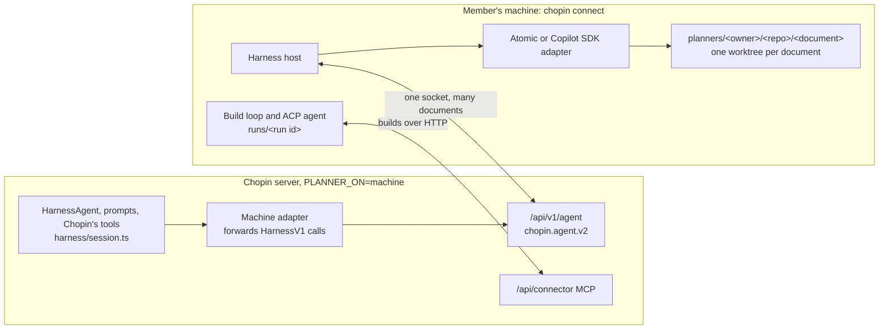
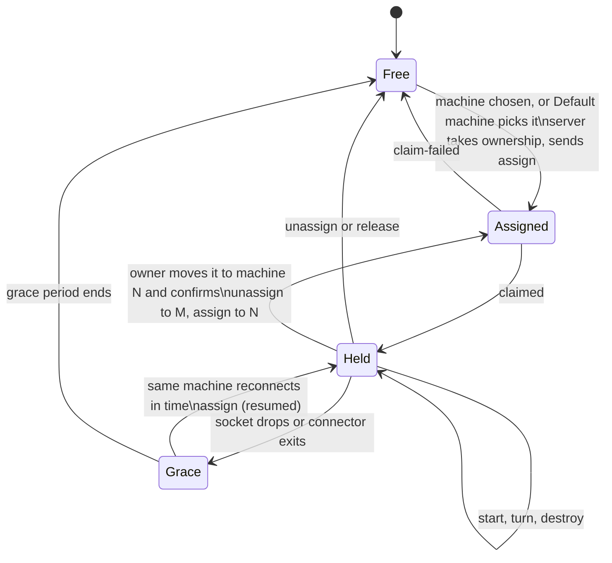

# Run Chopin's harnesses on a connected machine

Status: draft for review. Design only; nothing here is built yet.

## Summary

- A document's Planner can run on your own machine, with your model login, your repositories and your tools.
- You set it up with the `chopin connect` you already run for builds. There is no separate Planner program.
- The extensions and skills you give your agent load for builds and for the Planner alike.
- One connection per machine carries every document whose Planner that machine runs, in any of your repositories.
- Chat, Decisions, run cards and Stop/Resume work exactly as when the Planner runs on the server.

## What this replaces

| Today                                                                                                                       | With this design                                                                 |
| --------------------------------------------------------------------------------------------------------------------------- | -------------------------------------------------------------------------------- |
| `HARNESS=remote`                                                                                                            | `PLANNER_ON=machine`; `HARNESS` names the adapter the machine runs               |
| `chopin connect --planner-command <command>` and `--planner <document URL>`                                                 | `chopin connect --agent atomic` or `--agent copilot`                             |
| A backend command per document, attaching with a 15-minute `chopin_p_` credential from `POST /api/connector/planner`        | One agent connection per machine, authorized by the connector's connection token |
| `chopin.agent.v1`: one socket per document, opened with `attach`                                                            | `chopin.agent.v2`: one socket per machine; documents arrive with `assign`        |
| A person's own agent session attaching with their GitHub token                                                              | That person runs `chopin connect`, and the Planner runs through their machine    |
| The Planner list in the connector's `wait_for_work` answers                                                                 | `assign` and `unassign` on the agent connection                                  |
| `CHOPIN_PLANNER_TOKEN`, `CHOPIN_DOCUMENT`, `CHOPIN_WORKTREE` and the `CHOPIN_GITHUB_TOKEN` variables a backend command gets | Nothing to read: the connector holds the connection, worktree and token          |

## Scope

In scope:

- Run a document's Planner on a member's machine with the adapters Chopin already ships and tests.
- Open one agent connection per `chopin connect`, for every document that machine serves.
- Keep every guarantee a Planner has today, and show the machine's Planner in `chopin status`.

Out of scope:

- Builds stay on ACP and the connector's MCP work loop.
- Summary and research jobs stay off: `PLANNER_ON=machine` requires `BACKGROUND_JOBS=off`.
- Sessions stay disposable: none survives a dropped connection, a server restart or a move.
- Live Atomic workflow runs never move between machines.
- No adapters beyond Atomic, Copilot SDK and an optional ACP fallback.

## Architecture



The server keeps the document, Chopin's tools, prompts, Decisions and permission checks. Its
forwarding adapter already exists; it now finds the socket by machine and document.

The new harness host inside `chopin connect` turns each message into a call on the same `HarnessV1`
adapter the server would run. The agent connection already carries those calls, with tests on both
sides, so the harness host is the only new piece.

## Server settings

| Variable                                        | `PLANNER_ON=server` (default) | `PLANNER_ON=machine`                                                                                                     |
| ----------------------------------------------- | ----------------------------- | ------------------------------------------------------------------------------------------------------------------------ |
| `HARNESS`                                       | Adapter the server runs       | Adapter every machine must run, `atomic` (default) or `copilot-sdk`. A machine offering another is refused (decision 8). |
| `HARNESS_AUTH`                                  | As today                      | Refused at startup: model logins live on the machines                                                                    |
| `HARNESS_EXTENSIONS`                            | As today, Atomic only         | Refused at startup: extensions come from each machine's connect settings                                                 |
| `MODEL`                                         | As today                      | Optional; sent as each turn's requested model                                                                            |
| `BACKGROUND_JOBS`                               | As today                      | Must be `off`                                                                                                            |
| `/api/v1/agent`                                 | 404                           | Speaks `chopin.agent.v2` only                                                                                            |
| `PLANNER_ATTACH_GRACE_MS`, `AGENT_CONNECTION_*` | Unused                        | As today, applied per machine connection                                                                                 |

## Machine settings

The Planner uses the agent settings builds use. For Atomic, the connector reads Atomic's own
resource flags from the words after `--`:

```sh
chopin connect --agent atomic -- -e /opt/planner-pkg --skill /home/me/skills/review --model openai/gpt-5.5
```

| Words after `--`                  | Builds                           | Planner                                                        |
| --------------------------------- | -------------------------------- | -------------------------------------------------------------- |
| `-e <path>`, `--extension <path>` | Passed to `atomic-acp`, as today | Loaded into every Planner session (`additionalExtensionPaths`) |
| `--skill <path>`                  | Passed to `atomic-acp`, as today | Loaded into every Planner session (`additionalSkillPaths`)     |
| `--model <provider/model>`        | Passed to `atomic-acp`, as today | Model used when the server sends none                          |
| Anything else                     | Passed to `atomic-acp`, as today | Ignored; `chopin status` lists it                              |

A package path loads its extensions, skills and workflows together, as `HARNESS_EXTENSIONS` does on
the server; paths must be absolute and exist. So a Planner product ships as an Atomic package, and
Chopin's adapter handles the connection, worktree, Decisions and run reports for it.

Two options apply to the Planner only:

| Option                   | Effect                                                                                                                                                    |
| ------------------------ | --------------------------------------------------------------------------------------------------------------------------------------------------------- |
| `--planner-sessions <n>` | How many Planner sessions the machine runs at once. Default 2 (decision 7).                                                                               |
| `--planner-tools`        | Also offers the tools of connect-configured extensions on Planner turns, listed in Work details. Without it they work only inside workflows (decision 6). |

A machine runs Planners only when its agent has a harness adapter: `--agent atomic` from PR 4 and
`--agent copilot` from PR 7. An agent given as an ACP command after `--` runs builds only.
`chopin connect` saves these settings with the agent's absolute path for `chopin service install`.

## Which machine runs a document's Planner

The server decides, with the rule it uses today (`plannerDocuments` in
`apps/server/src/experiments/routes.ts`):

| The document's **Machine** setting | Its Planner runs on                                                                                                                                                  |
| ---------------------------------- | -------------------------------------------------------------------------------------------------------------------------------------------------------------------- |
| A machine someone chose            | That machine, while it is connected                                                                                                                                  |
| **Default machine**                | The creator's machine, while the document is in use: their favorite, else the machine last used for the document, else any of theirs that runs Planners (decision 3) |

A document is in use while it is open, while someone asks its Planner for something, or while its
Planner waits on a question or a workflow run. After 30 minutes without any of these, Default
machine stops its Planner. While its machine can run it, a Default machine Planner stays put.

A document has one Planner at a time, and the server takes ownership for the machine owner before
it sends `assign`. To plan with your own agent, connect your machine and choose it, or leave
Default machine on a document you created. With no machine able to run it, `@chopin` and
`invoke_planner` are refused with a message saying how to connect one.

## Messages

`chopin.agent.v2` keeps every rule in [Agent connection](agent-connection.md) it does not change
here. That covers frame limits, strict objects, pings, close codes, stream parts, structured tool
errors, questions and run reports.

### Endpoint

- The path stays `/api/v1/agent`. The upgrade must offer `chopin.agent.v2`; anything else gets 426
  with `"supported": ["chopin.agent.v2"]`.
- The bearer is the connection token `POST /api/connector/connections` returns. It names the
  machine and ends with that connection or a server restart. Any other bearer gets 401.
- The connector opens the socket after its MCP connection registers and closes it when that
  connection ends.

### Message list

| Message                                         | From           | `HarnessV1` call              | Promise                                                                         |
| ----------------------------------------------- | -------------- | ----------------------------- | ------------------------------------------------------------------------------- |
| `hello`, `welcome`, `refused`                   | machine/server | none                          | The machine names its harness; the server takes it or refuses                   |
| `assign`, `claimed`, `claim-failed`             | server/machine | none                          | The machine holds this document's Planner, with its worktree and adapter ready  |
| `unassign`, `release`                           | either         | none                          | The machine no longer holds the document; its sessions end; no grace period     |
| `start`, `started`, `start-failed`              | server/machine | `doStart`                     | One harness session exists for one held document                                |
| `turn`, `tools`, `part`, `turn-end`             | both           | `doPromptTurn`, `emit`        | One prompt turn runs to exactly one end                                         |
| `abort`                                         | server         | the turn's `abortSignal`      | The turn stops                                                                  |
| `host-tool-call`, `host-tool-result`            | machine/server | tool call, `submitToolResult` | A Chopin tool runs in the server; the only way the machine changes the document |
| `input-request`, `input-cancel`, `input-result` | both           | Atomic HostInput              | A question becomes Decisions and waits until answered or withdrawn              |
| `runs`, `stop`, `resume`, `control-result`      | both           | Atomic workflow runs          | The session's workflow runs are reported and controlled                         |
| `destroy`, `detach`, `error`                    | both           | `doDestroy`                   | The session or the connection ends                                              |

The `hello` and document messages are new, and `start` and `started` gain fields. Every other
message keeps its current shape, including run reports with the `stopped` status and stage
`parentIds`. Ids are unique per connection, so routing by session is enough.

### Handshake

```text
client  { "type": "hello", "version": 2, "harness": { "name": "atomic", "version": "0.9.37" },
          "resources": { "extensions": ["planner-pkg"], "skills": ["review"] }, "capacity": { "sessions": 2 } }
server  { "type": "welcome", "version": 2, "machine": { "id": "m_…", "label": "build-box" },
          "harness": { "name": "atomic", "version": "0.9.37" }, "model": "openai/gpt-5.5" }
server  { "type": "refused", "code": "harness-unsupported", "message": "This Chopin runs Planners with copilot-sdk; this machine offers atomic." }
```

- `resources` carries names only, never paths, for the Machines page and Chat's machine menu.
- `welcome.harness.version` is the version the server asks for. If the managed install lacks it,
  the connector installs it before it answers any `assign` ([Bundling](#bundling)).
- `capacity.sessions` caps the sessions the server starts on this machine. Live workflow runs do
  not count against it (decision 7).

| New refusal code      | Close code | Meaning                                                                                             |
| --------------------- | ---------- | --------------------------------------------------------------------------------------------------- |
| `harness-unsupported` | 4422       | The machine offers another harness, or its `chopin` release cannot run the requested Atomic version |
| `machine-revoked`     | 4403       | The machine was disconnected in Chopin or must be paired again                                      |

### Documents and sessions

```text
server  { "type": "assign", "document": { "id": "5f0c…e21", "title": "Score export", "url": "https://chopin.example/octo-org/score/plan", "repository": "octo-org/score" }, "resumed": false }
client  { "type": "claimed", "document": "5f0c…e21" }
client  { "type": "claim-failed", "document": "5f0c…e21", "code": "no-checkout", "message": "This machine has no checkout of octo-org/score." }
server  { "type": "start", "session": "s_…", "document": "5f0c…e21", "mode": "planner" }
client  { "type": "started", "session": "s_…", "workspace": { "kind": "worktree", "branch": "chopin/planner/5f0c…e21", "head": "3f2c…" } }
client  { "type": "start-failed", "session": "s_…", "code": "at-capacity", "message": "This machine already runs 2 Planner sessions." }
server  { "type": "unassign", "document": "5f0c…e21", "code": "chosen-elsewhere", "message": "octocat chose studio for this document, so build-box stopped running its Planner." }
client  { "type": "release", "document": "5f0c…e21" }
```

The connector sends `claimed` once the worktree and adapter are ready; until then Chat says
**Planner: starting on build-box…**. `start.document` must be a document the connection holds, and
`started.workspace` lets the server tell the Planner it works in a worktree. The connector prints
each `unassign` message.

| `claim-failed` or `start-failed` code | Meaning                                                                  |
| ------------------------------------- | ------------------------------------------------------------------------ |
| `no-checkout`                         | No checkout or clone of the repository (machines without a GitHub token) |
| `worktree-failed`                     | `git worktree add` failed                                                |
| `harness-unavailable`                 | The requested adapter version could not be installed or loaded           |
| `at-capacity`                         | Every session slot is in use                                             |
| `failed`                              | Anything else                                                            |

| `unassign` code                         | Cause                                                                            |
| --------------------------------------- | -------------------------------------------------------------------------------- |
| `chosen-elsewhere`                      | The owner chose another machine, or their favorite changed under Default machine |
| `unused`                                | Default machine stopped the Planner after 30 minutes unused                      |
| `access-revoked`                        | The owner lost push or admin access, or instance admission                       |
| `document-archived`, `document-deleted` | The document was archived or deleted                                             |
| `planner-reset`                         | A repository writer reset the document's Planner                                 |
| `machine-revoked`                       | The machine was disconnected in Chopin; the socket closes too                    |

## Session lifecycle



| State    | Who holds the Planner                            | Sessions                                       |
| -------- | ------------------------------------------------ | ---------------------------------------------- |
| Free     | Nobody                                           | None                                           |
| Assigned | The machine owner; the machine is getting ready  | None                                           |
| Held     | The machine owner                                | Up to `capacity.sessions`, started on demand   |
| Grace    | The machine owner, for `PLANNER_ATTACH_GRACE_MS` | None: turns ended and open questions withdrawn |

- **Rechecks.** Before every `start` and `turn`, and every 5 minutes, the server checks the
  machine, the owner's access and the document. A failure sends `unassign`, or closes the socket
  when the machine itself fails.
- **Grace.** A dropped socket or an exiting connector puts every held document into grace
  (decision 9). Reconnecting in time brings `assign` with `resumed: true`; no turn is replayed.
- **Moves.** A move starts fresh sessions from the bounded transcript and the current document. If
  the old machine has live workflow runs, the menu lists them and moves only once the owner
  confirms they will stop (decision 4).
- **Server restart.** Every ownership ends. Reconnecting machines get `assign` for documents still
  chosen; Default machine assigns again on next use.

## Builds and Planners on one machine

| Concern         | Behavior                                                                                                                                                                                                                     |
| --------------- | ---------------------------------------------------------------------------------------------------------------------------------------------------------------------------------------------------------------------------- |
| Worktrees       | Builds keep `runs/<run id>`. Each Planner works in `planners/<owner>/<repo>/<document id>`, which the connector creates with `git worktree add --detach` at `origin`'s default branch and never resets while it has changes. |
| Source          | The worktree comes from the repository's `--checkout`, else from the clone in `repos/<owner>/<repo>`, fetched first.                                                                                                         |
| Retention       | `--keep-runs` applies to build runs only. Planner worktrees stay until removed by hand.                                                                                                                                      |
| Running at once | Builds and Planner sessions run in parallel and share no worktree. Builds keep today's queue.                                                                                                                                |
| Git locks       | Worktree creation retries when the repository's own Git operations hold a lock.                                                                                                                                              |
| Shutdown        | Ctrl-C reports running builds stopped, destroys sessions and closes the socket with `detach`. Held documents go into grace. A second Ctrl-C exits at once.                                                                   |

## Security

| Credential                                                 | Where it lives                           | What the Planner's harness gets                                                                                                                                  |
| ---------------------------------------------------------- | ---------------------------------------- | ---------------------------------------------------------------------------------------------------------------------------------------------------------------- |
| Model login (`~/.atomic/agent/auth.json`, `copilot login`) | The machine                              | The adapter reads it in memory. It never reaches Chopin.                                                                                                         |
| The machine's GitHub authorization, for Chopin's tools     | The server                               | Nothing. Chopin's tools run in the server as the machine owner.                                                                                                  |
| The owner's GitHub App token, for pushing                  | The connector, renewed before it expires | Per session, the way a build's agent gets it: `GH_TOKEN`, `GITHUB_TOKEN` and Git's credential helper for the document's repository, reading a `0600` token file. |
| Connection token                                           | Connector memory                         | Nothing.                                                                                                                                                         |
| Machine token `chopin_m_`                                  | The base dir                             | Not given, but readable by any process of the same user (risk 3).                                                                                                |
| `--env` values                                             | `config.json`, mode `0600`               | In the environment, as for builds.                                                                                                                               |

- The server takes the machine's stream parts and run reports at its word. It checks every Chopin
  tool call against the turn's tool list, and a reported run never starts a Planner turn.
- A machine plans only documents its owner chose it for, or its owner's own on Default machine.
  Extensions and skills run as the machine user; the server sees only their names.
- Pushes go from the machine to GitHub with the owner's token, as for builds
  ([Which GitHub account pushes](chopin-cli.md#which-github-account-pushes)).

## Bundling

`chopin` is one `bun build --compile` executable for each of five targets.

| Part                                       | Shape                                                                                               | Decision                                                                                                                        |
| ------------------------------------------ | --------------------------------------------------------------------------------------------------- | ------------------------------------------------------------------------------------------------------------------------------- |
| Chopin's adapter code (`packages/harness`) | TypeScript                                                                                          | Compiled in                                                                                                                     |
| `@ai-sdk/harness`, `@github/copilot-sdk`   | TypeScript and JavaScript                                                                           | Compiled in                                                                                                                     |
| `@bastani/atomic`                          | 51 MB, over 250 MB with dependencies, native modules for glibc and musl, and an embedded PostgreSQL | Loaded with `import()` from `<base dir>/harness/atomic/<version>`, installed with the machine's `npm` on first use (decision 5) |
| Copilot CLI                                | A native executable per platform                                                                    | The `copilot` whose absolute path `chopin connect` saved, version-checked at `hello`                                            |

Embedding Atomic would grow the CLI by hundreds of megabytes for everyone, builds-only users
included. A machine set up for `--agent atomic` already has Node.js 22.19 and `npm`. PR 6 proves
the compiled binary can `import()` that install on all five targets (risk 1).

## Observability

`chopin status` gains Planner lines, and `--json` the same fields under `planner`:

```text
Connector:  running (pid 4242, chopin 0.0.14, the service)
Planner:    atomic 0.9.37 from /home/me/.local/state/chopin/connector/harness/atomic/0.9.37
            extensions: planner-pkg · skills: review · ignored: --thinking high
            agent connection up since 10:42, 2 of 2 sessions in use, 1 workflow run live
            https://chopin.example/octo-org/score/plan     turn running 34s
            https://chopin.example/octo-org/site/roadmap   idle, held since 09:15
```

- A failing document shows its last error with tokens masked. The connector keeps this state in its
  base dir, so `chopin status` reads it from another process.
- The Machines page shows "Runs Planners with Atomic 0.9.37" and the resource names from `hello`.
- Server logs name each assign, claim, unassign and grace expiry by machine, document and code,
  never prompts or tool inputs.

## Alternatives

| Option                                                                                                            | Verdict                                                                                                      |
| ----------------------------------------------------------------------------------------------------------------- | ------------------------------------------------------------------------------------------------------------ |
| A. Keep today's setup, the left column of [What this replaces](#what-this-replaces), and ship a reference backend | Rejected: still a process, socket and credential per document, and settings split between builds and Planner |
| B. Split at `HarnessV1`, harness host in `chopin connect`, one socket per machine                                 | **Chosen**: reuses the tested adapters and session messages; one place for agent settings                    |
| C. Run the whole Planner, prompts and tools included, on the machine                                              | Rejected: permission checks and document writes would trust the machine                                      |
| D. One socket per document, opened by the connector                                                               | Rejected: N sockets per machine, and no place for machine-wide harness and capacity                          |
| E. Run the adapter in a child process                                                                             | Deferred (decision 2): better isolation, but a second local protocol on day one                              |
| F. ACP as the only Planner transport                                                                              | Fallback only (PR 9): ACP has no tool results from the host, structured output, HostInput or run control     |
| G. Keep direct attach for a person's own session beside v2                                                        | Rejected (decision 1): two admission paths, and a Planner tied to a browser sign-in                          |

## Rollout

Each PR stands alone and leaves `main` working. Until PR 8, a server runs either today's path or
`PLANNER_ON=machine`, never both.

1. **Shared adapters.** Move the Atomic and Copilot SDK adapters into `packages/harness`.
   - Acceptance: the Atomic, Copilot SDK and harness contract suites pass unchanged from there.
2. **v2 schemas.** Add `chopin.agent.v2` to `@chopin/agent-link` and to `agent-connection.md`.
   - Acceptance: protocol tests cover every new message and limit.
3. **Server.** `PLANNER_ON`, connection-token admission, assign, grace and move confirmation.
   - Acceptance: a v2 test client sees every transition in [Session lifecycle](#session-lifecycle).
4. **Connector.** The harness host, managed Atomic, worktrees, per-session tokens, both options.
   - Acceptance: with Atomic's stub model, `@chopin` edits, Decisions, Stop/Resume and a build pass.
5. **Status.** `chopin status` Planner lines, `--json`, and the Machines page harness line.
   - Acceptance: status snapshots pass and contain nothing `redacted()` would mask.
6. **Compiled binaries.** The binary loads the managed Atomic; `chopin harness check` reports it.
   - Acceptance: each CI target installs the pinned Atomic and runs one stub-model turn.
7. **Copilot on the machine.** The Copilot SDK adapter as the machine's user, version-checked.
   - Acceptance: the shared contract suite passes against the machine-hosted Copilot adapter.
8. **Removal.** Remove everything in [What this replaces](#what-this-replaces) and its docs.
   - Acceptance: retired setting and options fail with a pointer, and `bun run ci` passes.
9. **Optional ACP fallback.** An ACP Planner adapter using the connector's local MCP bridge.
   - Acceptance: the shared contract suite passes; capabilities ACP lacks refuse cleanly.

## Risks

1. **Compiled Bun may not load Atomic's native modules.** PR 6 checks first; the fallback is a
   Node.js helper hosting the adapter over stdio.
2. **Atomic shares the connector process.** A crash takes builds down too. A child process
   (alternative E) is a contained change if PR 4 shows trouble.
3. **Same-user access.** Extensions can read the machine token and `config.json`, as build agents
   can today.
4. **Version skew.** `hello`, `welcome` and `chopin harness check` catch an unsupported Atomic
   version and name the release to install (decision 11).
5. **One socket, many documents.** A 2 MiB frame delays other documents; PR 4 measures it.
6. **One process, many repositories.** Each repository has its own GitHub token, so each Atomic
   session needs its own environment. PR 4 proves it, or alternative E fixes it.
7. **Products outside Atomic's model.** `--planner-tools` covers the largest gap.

## Decisions

| #  | Decision                                                                                                     | Why                                                                      |
| -- | ------------------------------------------------------------------------------------------------------------ | ------------------------------------------------------------------------ |
| 1  | Every Planner off the server runs through a connected machine on `chopin.agent.v2`, including a person's own | One way to be a Planner, one admission path                              |
| 2  | The adapter runs in the connector process first, behind an interface                                         | Fewer moving parts now; a child process stays a contained change         |
| 3  | Default machine runs the Planner on the creator's machine, with today's rule                                 | Same meaning of Default machine for builds and Planners                  |
| 4  | Moving a document with live workflow runs asks the owner first                                               | Runs cannot move, so stopping them should be a choice                    |
| 5  | Atomic comes from a managed install at the version the server asks for                                       | A global install drifts from the tested version                          |
| 6  | Extension tools reach Planner turns only with `--planner-tools`                                              | The machine owner chose that code, so they opt in                        |
| 7  | Each machine runs at most 2 Planner sessions by default                                                      | Bounds load; live workflow runs take no slot                             |
| 8  | One `HARNESS` adapter per server under `PLANNER_ON=machine`                                                  | One adapter to test and support per deployment                           |
| 9  | A connector restart keeps ownership through the grace period, like a dropped socket                          | A quick restart should not hand the document to someone else             |
| 10 | No limit on live workflow runs per machine                                                                   | The machine owner decides how much work it takes on                      |
| 11 | Each `chopin` release declares the Atomic versions it supports and refuses others with `harness-unsupported` | Status and the log then name the release to install with `chopin update` |

## Glossary

| Term             | Meaning                                                                                     |
| ---------------- | ------------------------------------------------------------------------------------------- |
| Planner          | The agent that co-authors a document, asks questions through Decisions and starts workflows |
| Harness          | The runtime that drives the model: Atomic or Copilot SDK                                    |
| Adapter          | Chopin's `HarnessV1` code for one harness                                                   |
| Harness host     | The new part of `chopin connect` that runs an adapter for the documents its machine holds   |
| Machine          | A computer paired with Chopin; its running `chopin connect` is the connector                |
| Connection token | What a connector gets when it connects; it authorizes the agent connection                  |
| Holder           | The account whose machine runs a document's Planner; one at a time                          |
| Grace period     | How long a holder keeps a document after its socket drops (`PLANNER_ATTACH_GRACE_MS`)       |
| Default machine  | The **Machine** setting that runs the Planner on the creator's machine                      |
| Chopin's tools   | The tools that read and change the document; they always run in the server                  |
